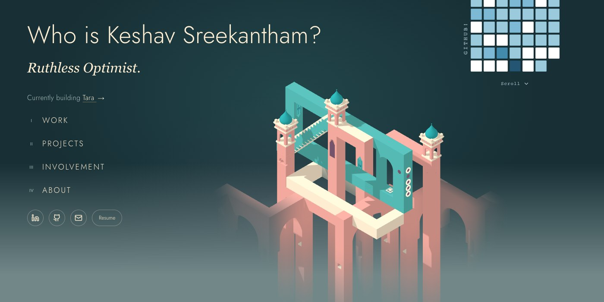
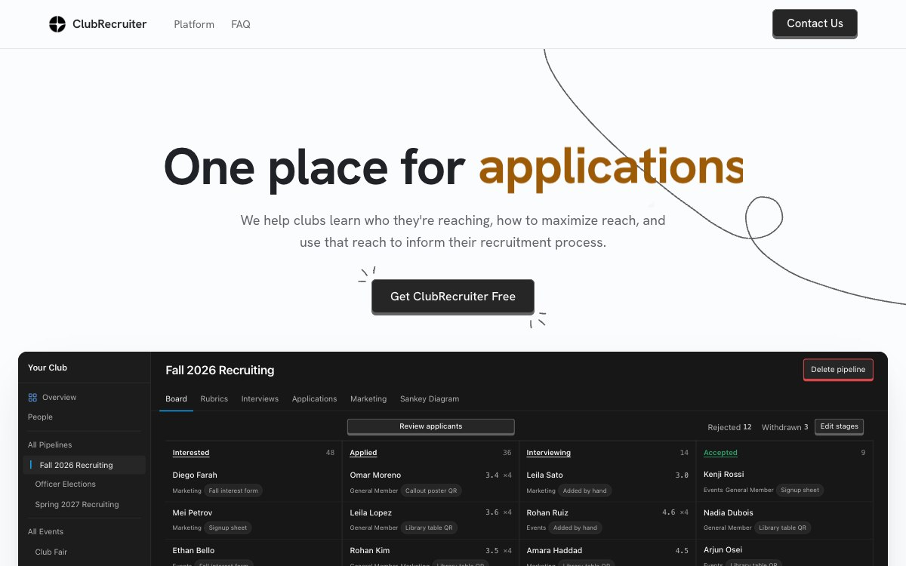
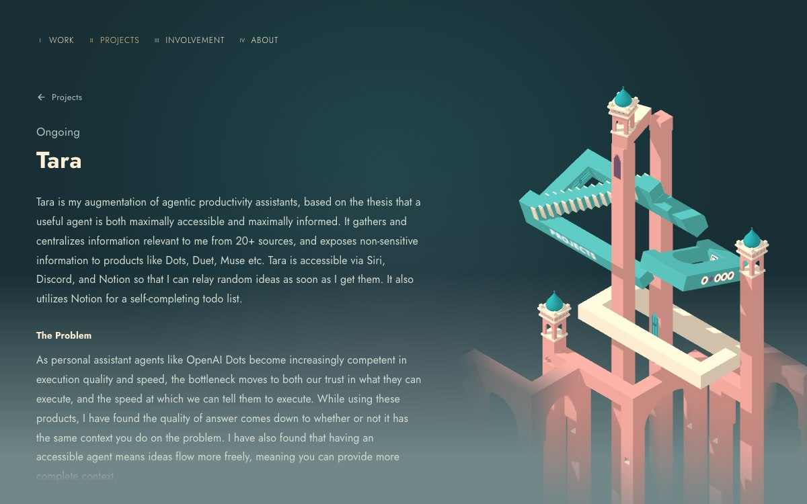
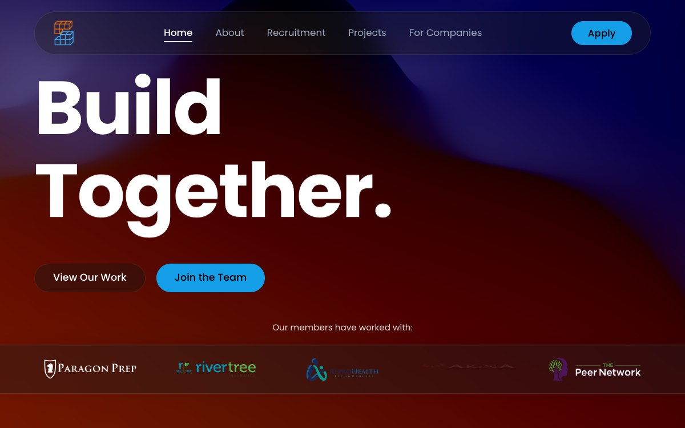
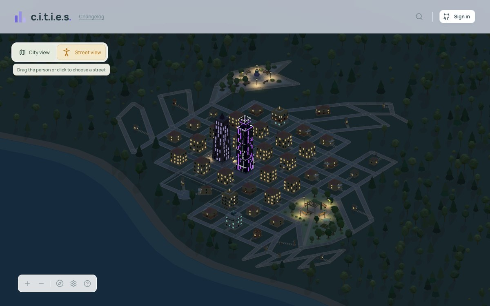
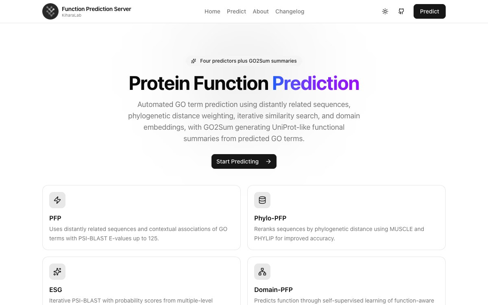
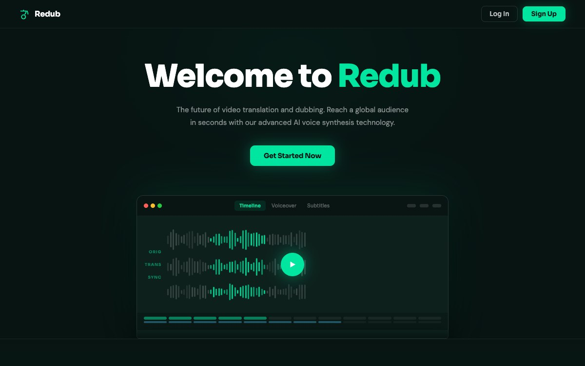

# Hey, I'm Keshav.

I've built entire tools used by 30% of the Fortune 100 and my solo initiatives have pulled 100k+ website visitors and 800k+ social media views. Incoming @ IBM, previously at NI and Spring Education. Junior at Purdue studying Data Science (Computer Science), graduating May 2028.

At Purdue, I'm a founding member and VP of Marketing @ Purdue Stack and Director of Accelerator @ ML@Purdue.

I'm <a href="https://www.keshavsreekantham.com/#projects"><picture><source media="(prefers-color-scheme: dark)" srcset="images/always-building-dark.gif"><source media="(prefers-color-scheme: light)" srcset="images/always-building-light.gif"></picture></a> See below.

<table>
  <tr>
    <td colspan="2">
       
      <strong>Website:</strong> <a href="https://www.keshavsreekantham.com/">keshavsreekantham.com</a>
    </td>
  </tr>
  <tr>
    <td width="50%">
       
      <strong>Website:</strong> <a href="https://www.clubrecruiter.app/home">ClubRecruiter</a>
    </td>
    <td width="50%">
       
      <strong>Portfolio:</strong> <a href="https://www.keshavsreekantham.com/#projects/tara">Tara</a>
    </td>
  </tr>
  <tr>
    <td width="50%">
       
      <strong>Website:</strong> <a href="https://www.purduestack.org/">Stack Website</a>
    </td>
    <td width="50%">
       
      <strong>Website:</strong> <a href="https://devcities.dev/">DevCities</a>
    </td>
  </tr>
  <tr>
    <td width="50%">
       
      <strong>Website:</strong> <a href="https://kiharalab.org/pfp">KiharaLab</a>
    </td>
    <td width="50%">
       
      <strong>Devpost:</strong> <a href="https://devpost.com/software/redub">Redub</a>
    </td>
  </tr>
</table>

<!-- Project gallery layout adapted from https://github.com/leereilly/leereilly. -->
