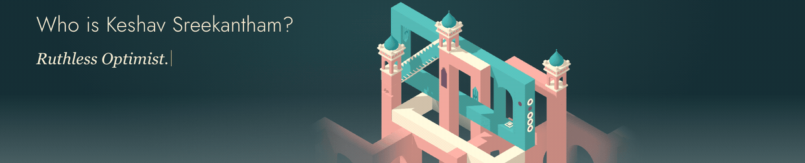
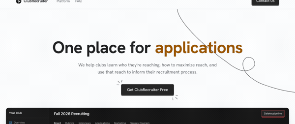
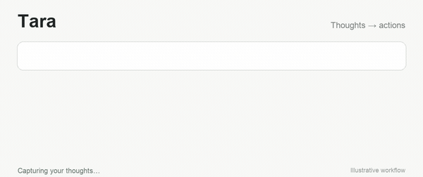
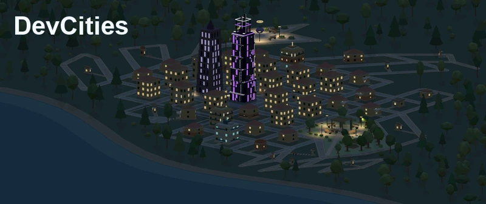
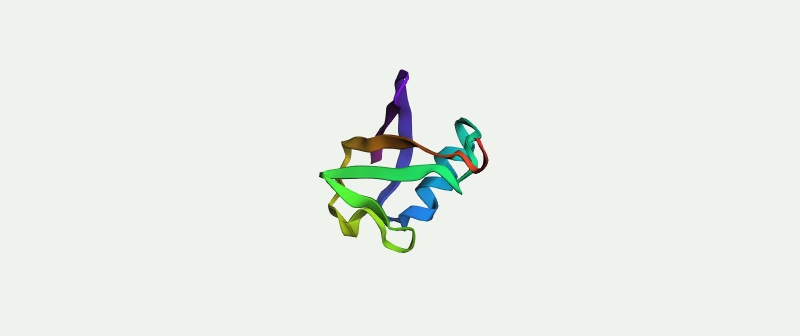
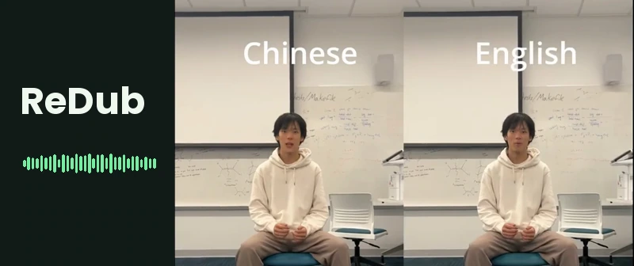

# Hey, I'm Keshav.

I've built entire tools used by 30% of the Fortune 100 and my solo initiatives have pulled 100k+ website visitors and 800k+ social media views. Incoming @ IBM, previously at NI and Spring Education. Junior at Purdue studying Data Science (Computer Science), graduating May 2028.

At Purdue, I'm a founding member and VP of Marketing @ Purdue Stack and Director of Accelerator @ ML@Purdue.

I'm <a href="https://www.keshavsreekantham.com/#projects"><picture><source media="(prefers-color-scheme: dark)" srcset="images/always-building-dark.gif"><source media="(prefers-color-scheme: light)" srcset="images/always-building-light.gif"></picture></a> See below.

<table>
  <tr>
    <td colspan="2" valign="top">
      <a href="https://www.keshavsreekantham.com/"><picture><source media="(max-width: 767px)" srcset="images/website-phone.gif"></picture></a> 
      keshavsreekantham.com
    </td>
  </tr>
  <tr>
    <td width="50%" valign="top">
      <a href="https://www.clubrecruiter.app/home"><picture><source media="(max-width: 767px)" srcset="images/clubrecruiter-phone.gif"></picture></a> 
      <strong>ClubRecruiter:</strong> 3000+ Users, 8 Organizations
    </td>
    <td width="50%" valign="top">
      <a href="https://www.keshavsreekantham.com/#projects/tara"><picture><source media="(max-width: 767px)" srcset="images/tara-phone.gif"></picture></a> 
      <strong>Tara:</strong> 20+ integrations → Auto Completing Todo List
    </td>
  </tr>
  <tr>
    <td width="50%" valign="top">
      <a href="https://www.purduestack.org/"><picture><source media="(max-width: 767px)" srcset="images/stack-motion-phone.gif"></picture></a> 
      <strong>Stack Website:</strong> 30k+ Views
    </td>
    <td width="50%" valign="top">
      <a href="https://devcities.dev/"><picture><source media="(max-width: 767px)" srcset="images/devcities-night-phone.webp"></picture></a> 
      <strong>DevCities:</strong> 10k+ Views, 40+ plots claimed
    </td>
  </tr>
  <tr>
    <td width="50%" valign="top">
      <a href="https://kiharalab.org/pfp"><picture><source media="(max-width: 767px)" srcset="images/protein-only-phone.webp"></picture></a> 
      <strong>KiharaLab:</strong> 4x speed optimization on lab algorithm
    </td>
    <td width="50%" valign="top">
      <a href="https://devpost.com/software/redub"><picture><source media="(max-width: 767px)" srcset="images/redub-synced-phone.webp"></picture></a> 
      <strong>Redub:</strong> 66% reduction on industry compute cost/min
    </td>
  </tr>
</table>

<!-- Project gallery layout adapted from https://github.com/leereilly/leereilly. -->
